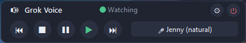

# Grokbot Voice

## Install or update

### Windows

Download [Grokbot.Voice.exe](https://github.com/chippybrown/voice-reader-for-grokbot/releases/latest/download/Grokbot.Voice.exe) and double-click it. There is no installer, and it does not need an administrator password. Close the old copy first. The first start copies the program into `%LOCALAPPDATA%\Grokbot Voice\app`. Later starts open that copy, so Windows does not unpack the whole program on every launch.

Windows SmartScreen may warn you. Click **More info**, then **Run anyway**.

If a window titled `find` keeps coming back from the old 1.3.1 updater, paste this into PowerShell. It closes the app and that updater, deletes the stuck files, downloads the latest program, and starts it.

```powershell
Stop-Process -Name 'Grokbot Voice','Grokbot.Voice' -Force -ErrorAction SilentlyContinue; Get-CimInstance Win32_Process -Filter "Name = 'cmd.exe'" | Where-Object { $_.CommandLine -like '*update-run.cmd*' } | ForEach-Object { Stop-Process -Id $_.ProcessId -Force -ErrorAction SilentlyContinue }; Remove-Item -Force -ErrorAction SilentlyContinue "$env:APPDATA\Grok Voice\update-run.cmd", "$env:APPDATA\Grok Voice\GrokbotVoice-update.exe"; $dir = "$env:LOCALAPPDATA\Grokbot Voice"; $app = Join-Path $dir 'app'; New-Item -ItemType Directory -Force -Path $dir | Out-Null; $zip = Join-Path $env:TEMP 'Grokbot-Voice-Windows.zip'; Invoke-WebRequest -Uri 'https://github.com/chippybrown/voice-reader-for-grokbot/releases/latest/download/Grokbot-Voice-Windows.zip' -OutFile $zip; $unpack = Join-Path $env:TEMP 'Grokbot-Voice-unpack'; if (Test-Path $unpack) { Remove-Item $unpack -Recurse -Force }; Expand-Archive -Path $zip -DestinationPath $unpack -Force; if (Test-Path $app) { Remove-Item $app -Recurse -Force }; Move-Item (Join-Path $unpack 'app') $app; Copy-Item (Join-Path $unpack 'Grokbot Voice.exe') (Join-Path $dir 'Grokbot.Voice.exe') -Force; if (Test-Path (Join-Path $dir '_internal')) { Remove-Item (Join-Path $dir '_internal') -Recurse -Force }; Start-Process (Join-Path $app 'Grokbot Voice.exe')
```

### Linux Mint

Paste this into a terminal. The same command installs Grokbot Voice the first time and updates it later.

```bash
curl -fsSL https://raw.githubusercontent.com/chippybrown/voice-reader-for-grokbot/main/install-mint.sh | bash
```

Or download the [AppImage](https://github.com/chippybrown/voice-reader-for-grokbot/releases/latest/download/Grokbot-Voice-x86_64.AppImage). Right-click it, choose **Properties**, then **Permissions**, and turn on **Allow executing file as program**. You can also run `chmod +x Grokbot-Voice-x86_64.AppImage`. Then double-click it.

A small app for people who'd rather listen than read. It runs on Windows and on Linux Mint.

Grokbot Voice sits on your screen as a little always-on-top toolbar. It watches the Grok Bot desktop app, and when a bot writes a new reply, it reads that reply aloud. Bot names and timestamps are skipped, so you hear the reply itself. You can use that bot's own Grok voice, a natural offline Piper voice, or a built-in voice (Windows voices, or espeak-ng on Linux).



## What you need

On Windows, Grokbot Voice works with the Grok Bot desktop app.

On Linux Mint, install the Grok Bot desktop app as well. Grokbot Voice reads that app's saved chats. The Linux steps are in [Linux Mint](#linux-mint) below.

## Install

1. Download [Grokbot.Voice.exe](https://github.com/chippybrown/voice-reader-for-grokbot/releases/latest/download/Grokbot.Voice.exe) and put it on your desktop.
2. Double-click it. Windows SmartScreen may warn you, because the app is not code-signed yet. Click **More info**, then **Run anyway**.
3. The toolbar starts in the lower right of the screen. Opening it again raises the window that is already running instead of starting a second copy. **Check for updates** in the gear menu compares this copy with the latest GitHub release. It says you're up to date, or that a newer version is available, and waits for **Update**. Once a day the bar can show **Update available**. It does not install by itself. Drag it anywhere you like. Drag an edge or a corner to make it wide and short, or tall and skinny. The buttons wrap, and stack in a column when the window is narrow. In Settings, **Toolbar** can be **Horizontal** or **Vertical**. Vertical stacks every button from top to bottom, which suits a screen edge or a portrait monitor. The size, the place, and that choice are remembered the next time you open it. It stays above your other windows.

## Voices

**Windows voices** (such as David and Zira) can speak as soon as you start. In Settings, open the voice list and choose **Get More Voices** to add more in Windows speech settings.

**Piper voices** sound more natural and run on your computer. The first time Grokbot Voice starts, and any time a voice is missing, it downloads Piper and a set of free English voices into its own folder. No administrator password and no question. The status line shows the progress. If you are offline, it keeps the voices it already has and uses a built-in voice until the next launch can try again.

The free voices are Jenny, Amy, Lessac, Alba, Cori, and LJ Speech (female), plus Ryan, Alan, and Joe (male). A new install speaks with **Jenny**. Every Piper voice in that folder shows up in the voice picker. You can still add another voice by putting its `.onnx` and `.onnx.json` files in the Piper folder and restarting:

- Windows: `%APPDATA%\Grok Voice\piper`
- Linux: `~/.config/grokbot-voice/piper`

**Grok voice (optional).** This uses the chief-of-staff bot's voice from the Grok Bot app. That bot is Moya unless you name a different one. The words are spoken by xAI's text-to-speech service. The steps are in the next section.

## Getting your xAI API key (for the Grok voice)

You only need this if you want the Grok voice. Windows and Piper voices work with no key at all.

1. Sign in at [console.x.ai](https://console.x.ai) with an X account or an xAI account.
2. Open **Billing** and add credits. This is separate from any Grok or X subscription. Speech costs roughly $15 per 1 million characters, about a penny per reply.
3. Open **API Keys**, create an API key, and copy it.
4. In Grokbot Voice, open the gear, click the voice name, and choose **Set xAI API key...**. Paste the key and click **Save**.

On Windows the key is saved encrypted for your Windows account only (Windows DPAPI). On Linux it is saved in your login keyring. You do not have to paste it again.

If the key has no credits, or it hits its spending limit, Grokbot Voice quietly reads that reply with a free local voice instead. The same thing happens if you are offline or xAI reports any other error. It tries Jenny when that Piper voice is installed, then any other Piper voice you added. The next reply tries the Grok voice again. A Windows voice is there whenever you pick one in Settings.

## The buttons

The buttons stay quiet. Only **Test** in Settings speaks. Everything else just does its job.

- **Back** reads the previous reply. Press it again to go further back.
- **Stop** stops the reply that is playing and stops monitoring. The Stop button turns red, and the status says **Not monitoring**.
- **Pause** holds in the middle of the reply and remembers the spot. The Pause button turns amber, and the status says **Reading paused**.
- **Play** is the green button. After Stop, it starts monitoring again. Replies that arrived while monitoring was off are skipped. After Pause, Play continues from the spot where reading held.
- **Next** steps forward through earlier replies. On the newest reply, Next stops and waits for the next new one.
- **Gear** opens Settings. The default voice has its own speed and pitch. Each voice remembers those. Below that, every bot that has been seen has a checkbox, a voice, and its own speed and pitch. A bot with no voice picked uses the default voice. Uncheck a bot and its new replies stay quiet, even in the open chat. **Back**, **Next**, and **Play** still speak that bot. **New bots on by default** is on, so a bot you have not set yet is read aloud. The Grok voice uses the speed (xAI keeps it in a comfortable range). Pitch applies to Windows and Piper voices. **Test** plays a short sample of the default voice, **Reset** puts that voice back to normal, and **Done** closes the panel. Open the voice list there and choose **Set xAI API key...** when you want the Grok voice. Hover any toolbar button for a short description. Stop, Pause, and Turn off include their keyboard shortcut.
- **Status light** is green for Watching, blue for Reading, amber for Reading paused, and red for Not monitoring.
- **Turn off** is the red button in the top right. It closes Grokbot Voice.

When Grokbot Voice starts, or starts again, replies already in the chat stay quiet. Only a reply that arrives after launch is read. **Back** and **Next** still move through the earlier ones. It reads only the text bubbles shown in the open chat. Tool calls, reasoning, status, todos, widgets, and notes to other agents are left out. A link is spoken as its label, not its address. The same message is not spoken again if the file is rewritten or you switch chats and come back.

On Linux, opening a different saved chat stays quiet the same way, until a new reply arrives in that chat. On Windows, switching to another chat reads only the bottom reply, and **Back** steps up from there.

## Keyboard shortcuts

These work from any window:

- `Ctrl+Alt+S` stops reading and stops monitoring
- `Ctrl+Alt+P` pauses, or continues from the paused spot
- `Ctrl+Alt+Q` quits

On Linux these shortcuts use the normal keyboard and do not need an administrator password. Linux Mint Cinnamon uses X11, where they work. On a Wayland session they usually do not, and the on-screen buttons still do.

## Where settings are saved

Your choices are stored under `%APPDATA%` (usually `C:\Users\YourName\AppData\Roaming`):

- `%APPDATA%\Grok Reader voice.txt` remembers the voice you picked
- `%APPDATA%\Grok Voice\voice settings.json` remembers speed and pitch for each voice
- `%APPDATA%\Grok Voice\bot settings.json` remembers each bot's voice, speed, pitch, and whether it is read aloud
- `%APPDATA%\Grok Voice\window.json` remembers the window size, position, and whether the toolbar is horizontal or vertical. On Linux that file is `~/.config/grokbot-voice/window.json`
- `%APPDATA%\Grok Voice\piper` is where Piper voice files go
- `%APPDATA%\Grok Voice\xai key.bin` is your xAI API key, encrypted for your Windows account
- `%APPDATA%\Grok Voice\chief of staff.txt` is optional. Put a bot's name on the first line if the chief of staff should be someone other than Moya

On Linux the same settings live in `~/.config/grokbot-voice/` (voice choice, speed and pitch, per-bot voices, Piper models, and the optional chief-of-staff name). The xAI key is in the login keyring, not in that folder. See [Linux Mint](#linux-mint).

The bar and Settings show the version from `version.py`. This build is **Grokbot Voice v1.4.1**.

## Build from source

On Windows, with Python 3.12:

```bat
pip install -r requirements.txt
pyinstaller --noconfirm --onedir --noconsole --name "Grokbot Voice" --icon grokbot_voice.ico --add-data "grokbot_voice.ico;." --collect-all uiautomation --collect-all piper --collect-all onnxruntime --hidden-import comtypes.stream --hidden-import platform_win --hidden-import grok_store --hidden-import audio_util --hidden-import version --hidden-import bot_prefs --hidden-import window_layout --hidden-import piper_setup --hidden-import single_instance --hidden-import updates --exclude-module vosk grok_voice.py
```

The program is written to `dist\Grokbot Voice.exe`.

On Linux the matching build is in [Linux Mint](#linux-mint). A version tag also builds `Grokbot-Voice-x86_64.AppImage` and `grokbot-voice-linux-x86_64` on Ubuntu 22.04.

Pushing a version tag such as `v1.3.0` runs that same build on GitHub and attaches `Grokbot Voice.exe` to the release, plus the Linux files. The release name is taken from `version.py`. You can also start the workflow by hand from the Actions tab.

## Linux Mint

The short way is one command. Paste it in a terminal. An administrator gets everything: the system packages, the app, a menu entry, a desktop icon, and Piper with the Jenny, Amy, and Lessac voices. Run it again any time to update. It asks before turning on start-at-login, and the answer is No if there is no terminal.

```bash
curl -fsSL https://raw.githubusercontent.com/chippybrown/voice-reader-for-grokbot/main/install-mint.sh | bash
```

If you are not an administrator and those packages are already installed, the same command skips apt and continues. You can also force that with:

```bash
curl -fsSL https://raw.githubusercontent.com/chippybrown/voice-reader-for-grokbot/main/install-mint.sh | bash -s -- --no-apt
```

If something is still missing, it prints the exact `sudo apt-get install` line for an administrator and stops.

To remove the app later:

```bash
bash ~/.local/share/grokbot-voice/install-mint.sh --uninstall
```

That removes the program, the menu entry, and the desktop icon. Your settings, Piper voices, and xAI key stay.

Open the gear to switch voices. On a new install the voice is **Jenny (natural)**. Amy and Lessac are in the same list. espeak-ng is still there if you want it.

Grok Bot itself has a Linux desktop app. Download the **Linux .deb (x64)** from [cursor.com/download/bot](https://cursor.com/download/bot), then install it:

```bash
sudo apt install ./Grok_Bot_*.deb
```

Open Grok Bot once and sign in, so it can save chats on this computer. Grokbot Voice reads those saved chats. It does not read pixels off the screen.

### 1. Install the packages Grokbot Voice needs

Open a terminal and paste:

```bash
sudo apt update
sudo apt install python3 python3-tk python3-pip espeak-ng pulseaudio-utils gnome-keyring libsecret-1-0
```

- `python3-tk` draws the little toolbar.
- `espeak-ng` is the built-in voice, the stand-in for the Windows voices.
- `pulseaudio-utils` provides `paplay`, which plays the sound. If you are on PipeWire and `paplay` is missing, install the package that provides `pw-play` (often `pipewire-bin` or `pipewire`).
- `gnome-keyring` and `libsecret` store the xAI key. Linux Mint Cinnamon starts the keyring when you log in.

### 2. Run Grokbot Voice

Download the [AppImage](https://github.com/chippybrown/voice-reader-for-grokbot/releases/latest/download/Grokbot-Voice-x86_64.AppImage). It is attached to the latest release, the same way the Windows exe is. Then:

```bash
chmod +x Grokbot-Voice-x86_64.AppImage
./Grokbot-Voice-x86_64.AppImage
```

The same toolbar appears. Drag it where you like. There is also a plain binary named `grokbot-voice-linux-x86_64` if you would rather not use an AppImage.

To run from this source folder instead:

```bash
python3 -m pip install -r requirements-linux.txt
python3 grok_voice.py
```

### 3. Piper voices

The installer, and the app itself the first time it starts, download Piper and the free English voices into `~/.config/grokbot-voice/piper`: Jenny, Amy, Lessac, Alba, Cori, LJ Speech, Ryan, Alan, and Joe. Jenny is selected on a new install. Files that are already there are left alone. Open the gear and click the voice name to pick another one.

The Ubuntu package named `piper` is a game-controller tool, not this speech program. The installer does not use that package. You can point at a different Piper program with the `GROKBOT_PIPER` environment variable.

### 4. The xAI key

Use the same gear menu as on Windows: **Set xAI API key...**, paste the key from [console.x.ai](https://console.x.ai), and click **Save**. The key goes into your login keyring (Secret Service), not into a file. Speech is still billed on that xAI account. If the key is missing, out of credits, or xAI returns an error, Grokbot Voice uses Piper when you have it, and otherwise espeak-ng.

### Where the chats are

Grokbot Voice looks for Grok Bot's `sand-client-persistence` folder and follows only the conversation open in the app. It uses a saved selected agent when the files have one, otherwise the bot named in the Grok Bot window title, otherwise the conversation where you wrote most recently. Other bots are ignored, including ones still writing in the background. It checks, in order:

- `GROKBOT_CHAT_DIR`, if you set that variable
- the folder named in `~/.config/grokbot-voice/chat-folder.txt`, if that file exists
- `~/.config/Grok Bot/sand-client-persistence`
- `~/.config/grok-bot/sand-client-persistence`
- `~/.config/Grokbot/sand-client-persistence`
- Flatpak folders under `~/.var/app`
- Snap folders under `~/snap`

A line in `chat-folder.txt` can be the `sand-client-persistence` folder itself, or the `Grok Bot` folder that contains it.

### Keyboard shortcuts on Mint

`Ctrl+Alt+S`, `Ctrl+Alt+P`, and `Ctrl+Alt+Q` work from any window on X11, which is what Linux Mint Cinnamon uses, and they do not ask for a password. On Wayland those global keys usually do nothing. The buttons on the toolbar still work.

### Build a Linux binary yourself

On Ubuntu 22.04 or Linux Mint 21 or newer, with the packages from step 1:

```bash
python3 -m pip install -r requirements-linux.txt
python3 -m PyInstaller --noconfirm --onefile --noconsole --name grokbot-voice \
  --add-data "assets/icon.png:." \
  --hidden-import platform_linux --hidden-import grok_store --hidden-import audio_util \
  --hidden-import version --hidden-import bot_prefs --hidden-import window_layout --hidden-import piper_setup --hidden-import single_instance --hidden-import updates \
  --collect-all keyring --collect-all secretstorage --collect-all pynput \
  grok_voice.py
chmod +x packaging/linux/build-appimage.sh
packaging/linux/build-appimage.sh
```

That writes `dist/grokbot-voice` and, when `appimagetool` is installed, `dist/Grokbot-Voice-x86_64.AppImage`. GitHub builds the same files on Ubuntu 22.04 so they run on Mint.

## License

Grokbot Voice is free software under the [GNU General Public License v3.0](LICENSE). Piper TTS, which this app uses for the natural voices, is GPL software too, which is why this project uses GPL-3.0.

## Disclaimer

This is an independent hobby project. It is not made by or affiliated with xAI. Grok is a trademark of xAI.
